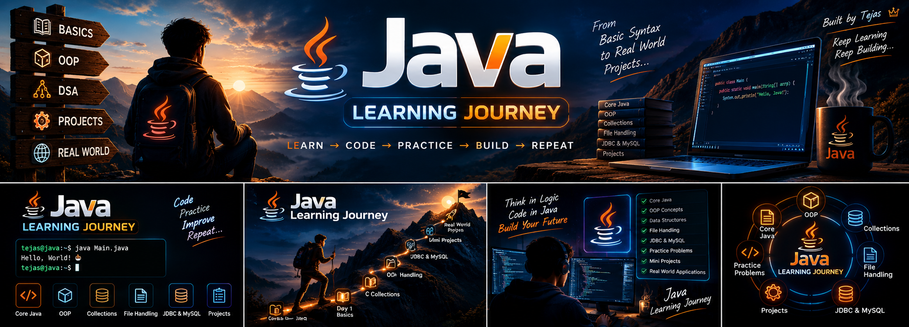
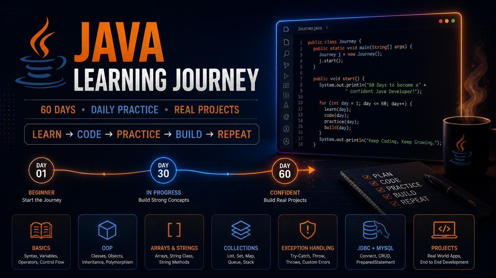
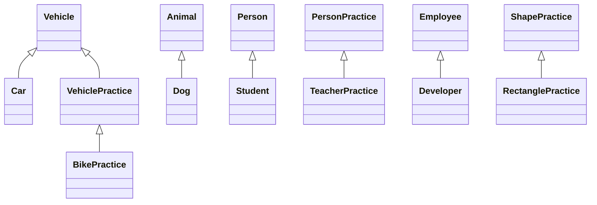

<div align="center">



# ☕ Java Learning Journey

[](https://www.java.com/)
[](https://github.com/tejasbargat16-ux/Java-Learning-Journey)
[](https://github.com/tejasbargat16-ux/Java-Learning-Journey)
[](https://github.com/tejasbargat16-ux)

**From Basic Syntax to Real-World Projects**  
*« Learn → Code → Practice → Build → Repeat 🔥 »*

---

</div>

## 📌 About The Journey

Welcome to my **Java Learning Journey**! 🚀

This repository documents my structured 60-day roadmap from core syntax fundamentals to advanced Object-Oriented Programming (OOP) and real-world projects. Every single day includes documented source code, conceptual notes, and practical problem-solving exercises.

---

## 🗺️ 60-Day Roadmap & Milestones

<div align="center">
  
</div>

---

## 🎯 My Goals

- 🧩 **Solid Foundations:** Master core Java syntax, operators, memory behavior, and control flow.
- 🧱 **Object-Oriented Excellence:** Deeply understand encapsulation, inheritance, polymorphism, and abstraction.
- 📦 **Data Structures & Collections:** Implement lists, sets, maps, queues, and explore their time complexities.
- 💾 **Data Persistence:** Work with Java File I/O and connect databases using JDBC & MySQL.
- 🛠️ **Real-World Projects:** Build robust console apps and full-stack software.
- 📖 **Document & Share:** Commit daily code to showcase consistent growth publicly on GitHub.

---

## 📚 Topics Covered

| Day | Topic | Highlights & Key Concepts | Status |
|:---:|:---|:---|:---:|
| **01** | [Basics](Day-01-Basics) | Hello World, Variables, Data Types, Basic Calculations | ✅ Completed |
| **02** | [Input & Operators](Day-02-Input-Operators) | Scanner Class, Arithmetic, Logical & Relational Operators | ✅ Completed |
| **03** | [Conditional Statements](Day-03-Conditional-Statements) | If-Else, Nested If, Switch Case, Grade & Bill Calculators | ✅ Completed |
| **04** | [Loops](Day-04-Loops) | For, While, Do-While, Break & Continue, Star Patterns, Fibonacci | ✅ Completed |
| **05** | [Arrays](Day-05-Arrays) | 1D & 2D Arrays, Element Search, Sorting, Matrix Operations | ✅ Completed |
| **06** | [Strings](Day-06-Strings) | String Methods, Immutability, Palindromes, Word & Char Counters | ✅ Completed |
| **07** | [Methods](Day-07-Methods) | Method Parameters, Return Types, Method Overloading, Recursion | ✅ Completed |
| **08** | [Classes & Objects](Day-08-Classes-Objects) | OOP Paradigm, Constructors, Instance Variables, `this` Keyword | ✅ Completed |
| **09** | [Encapsulation](Day-09-Encapsulation) | Access Modifiers, Getters & Setters, Data Hiding, Bank Demo | ✅ Completed |
| **10** | [Inheritance](Day-10—Inheritance) | `extends`, `super` Keyword, Method Overriding, Hierarchical Models | ✅ Completed |

---

## 🔜 Coming Up Next

```
Day 11 - 20: Polymorphism, Abstraction, Interfaces & Abstract Classes
Day 21 - 30: Exception Handling, Generics & Java Collections Framework (List, Set, Map)
Day 31 - 40: Java File I/O, Serialization, Multithreading & Concurrency
Day 41 - 50: JDBC & MySQL Database Connectivity (CRUD Operations & PreparedStatements)
Day 51 - 60: Real-World Applications & Capstone Projects
```

---

## 🏗️ Architecture & Concepts

### 1. Learning Progression Flow

```mermaid
flowchart LR
    A[Basics] --> B[Input & Operators]
    B --> C[Conditionals]
    C --> D[Loops]
    D --> E[Arrays]
    E --> F[Strings]
    F --> G[Methods]
    G --> H[Classes & Objects]
    H --> I[Encapsulation]
    I --> J[Inheritance]
    J --> K[Polymorphism & Abstraction]
    K --> L[Exceptions & Collections]
    L --> M[File Handling & JDBC]
    M --> N[Real-World Projects]
```



### 2. Inheritance Hierarchy (Day 10 Showcase)



---

## 🗂️ Repository Structure

```
Java-Learning-Journey/
├── Day-01-Basics/
├── Day-02-Input-Operators/
├── Day-03-Conditional-Statements/
├── Day-04-Loops/
├── Day-05-Arrays/
├── Day-06-Strings/
├── Day-07-Methods/
├── Day-08-Classes-Objects/
├── Day-09-Encapsulation/
├── Day-10—Inheritance/
├── images/
│   ├── banner.png
│   └── roadmap.jpg
├── .gitignore
└── README.md
```

> Each day folder contains dedicated Java source files, practice programs, and a dedicated `README.md` explaining theory and problem statements.

---

## ▶️ How to Run

### Prerequisites
- [JDK 17+](https://www.oracle.com/java/technologies/downloads/) installed.
- Terminal or any IDE (VS Code, IntelliJ IDEA, Eclipse).

### Compile & Execute Any Program

1. **Clone the repository:**
   ```bash
   git clone https://github.com/tejasbargat16-ux/Java-Learning-Journey.git
   cd Java-Learning-Journey
   ```

2. **Navigate to the topic folder:**
   ```bash
   cd Day-01-Basics
   ```

3. **Compile the Java file:**
   ```bash
   javac HelloWorld.java
   ```

4. **Run the compiled byte code:**
   ```bash
   java HelloWorld
   ```

> 💡 **Note:** Ensure class names match their corresponding `.java` file name when compiling and running Java programs.

---

## 📈 Current Progress

- **Completed:** Day 10 of 60 days
- **Status:** In Progress 🚀
- **Started:** September 2026

<div align="center">

**« Keep Learning, Keep Building, Keep Growing »**  
*Built with ❤️ by Tejas*

</div>

## 📂 Repo Structure
<!-- STRUCTURE:START -->
```
./
├── Day-01-Basics/
│   ├── BasicCalculation.java
│   ├── Calculator.java
│   ├── HelloWorld.java
│   ├── MyIntroduction.java
│   ├── PersonalProfile.java
│   ├── README.md
│   ├── StudentDetails.java
│   └── Variables.java
├── Day-02-Input-Operators/
│   ├── ArithmeticOperators.java
│   ├── Calculator.java
│   ├── MarksCalculator.java
│   ├── PersonalInfo.java
│   ├── README.md
│   ├── RectangleCalculator.java
│   ├── SimpleInterest.java
│   ├── StudentInput.java
│   └── UserInput.java
├── Day-03-Conditional-Statements/
│   ├── AgeChecker.java
│   ├── ElectricityBill.java
│   ├── EvenOdd.java
│   ├── GradeCalculator.java
│   ├── IfElseExample.java
│   ├── IfExample.java
│   ├── LargestNumber.java
│   ├── LargestOfThree.java
│   ├── LoginChecker.java
│   ├── NumberChecker.java
│   ├── PracticeResult.java
│   └── README.md
├── Day-04-Loops/
│   ├── BreakExample.java
│   ├── ContinueExample.java
│   ├── CountDigits.java
│   ├── Countdown.java
│   ├── DoWhileLoop.java
│   ├── EvenNumbers.java
│   ├── Factorial.java
│   ├── Fibonacci.java
│   ├── ForLoop.java
│   ├── NumberAnalyzer.java
│   ├── NumberTable.java
│   ├── PracticeSum.java
│   ├── PrimeNumber.java
│   ├── README.md
│   ├── ReverseNumber.java
│   ├── StarPattern.java
│   ├── SumOfNumbers.java
│   └── WhileLoop.java
├── Day-05-Arrays/
│   ├── ArrayAnalyzer.java
│   ├── ArrayAverage.java
│   ├── ArrayBasics.java
│   ├── ArrayInput.java
│   ├── ArraySum.java
│   ├── MatrixAddition.java.l
│   ├── MaximumElement.java
│   ├── MinimumElement.java
│   ├── PracticeEvenArray.java
│   ├── README.md
│   ├── ReverseArray.java
│   ├── SearchElement.java
│   ├── SortArray.java
│   └── TwoDimensionalArray.java
├── Day-06-Strings/
│   ├── CharacterAccess.java
│   ├── CharacterCounter.java
│   ├── CharacterFrequency.java
│   ├── Palindrome.java
│   ├── README.md
│   ├── RemoveSpaces.java
│   ├── ReverseString.java
│   ├── StringAnalyzer.java
│   ├── StringBasics.java
│   ├── StringCase.java
│   ├── StringComparison.java
│   ├── StringLength.java
│   ├── StringSearch.java
│   ├── SubstringExample.java
│   ├── VowelConsonant.java
│   ├── VowelCounter.java
│   └── WordCounter.java
├── Day-07-Methods/
│   ├── ArrayMethods.java
│   ├── CalculatorMethods.java
│   ├── EvenOddMethod.java
│   ├── FactorialMethod.java
│   ├── LargestMethod.java
│   ├── MethodOverloading.java
│   ├── ParameterMethod.java
│   ├── PracticeMethods.java
│   ├── README.md
│   ├── ReturnMethod.java
│   ├── SimpleMethod.java
│   ├── StringMethods.java
│   └── StudentResult.java
├── Day-08-Classes-Objects/
│   ├── BankAccount.java
│   ├── BankDemo.java
│   ├── Car.java
│   ├── CarDemo.java
│   ├── ConstructorExample.java
│   ├── Employee.java
│   ├── EmployeeDemo.java
│   ├── MobileDemo.java
│   ├── MobilePhone.java
│   ├── README.md
│   ├── Rectangle.java
│   ├── RectangleDemo.java
│   ├── Student.java
│   ├── StudentDemo.java
│   ├── StudentManagement.java
│   ├── Students.java
│   └── ThisKeyword.java
├── Day-09-Encapsulation/
│   ├── BankAccount.java
│   ├── BankAccountPractice.java
│   ├── BankDemo.java
│   ├── Employee.java
│   ├── EmployeeDemo.java
│   ├── EncapsulationBasic.java
│   ├── Mobile.java
│   ├── Person.java
│   ├── Product.java
│   ├── ProductDemo.java
│   ├── README.md
│   ├── SecureStudent.java
│   ├── Student.java
│   └── StudentDemo.java
├── Day-10—Inheritance/
│   ├── Animal.java
│   ├── AnimalDemo.java
│   ├── Car.java
│   ├── Developer.java
│   ├── Dog.java
│   ├── Employee.java
│   ├── EmployeeManagement.java
│   ├── Main.java
│   ├── Person.java
│   ├── README.md
│   ├── RectanglePractice.java
│   ├── Student.java
│   ├── StudentDemo.java
│   ├── TeacherPractice.java
│   ├── Vehicle.java
│   └── VehicleDemo.java
├── Day-11-Polymorphism/
│   ├── AnimalArrayDemo.java
│   ├── AnimalPoly.java
│   ├── AreaOverloading.java
│   ├── CalculatorOverloading.java
│   ├── CardPayment.java
│   ├── CatPoly.java
│   ├── Circle.java
│   ├── DogPoly.java
│   ├── EmployeeSalaryDemo.java
│   ├── NotificationDemo.java
│   ├── Payment.java
│   ├── PaymentDemo.java
│   ├── PolymorphismDemo.java
│   ├── README.md
│   ├── RectangleShape.java
│   ├── Shape.java
│   ├── ShapeCalculator.java
│   └── UPIPayment.java
├── images/
│   ├── banner.png
│   └── roadmap.jpg
├── README.md
└── structure.txt

13 directories, 160 files
```
<!-- STRUCTURE:END -->
