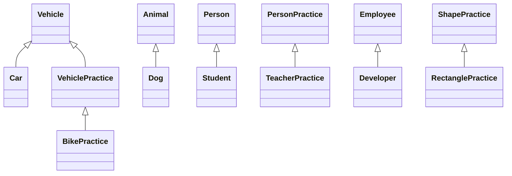
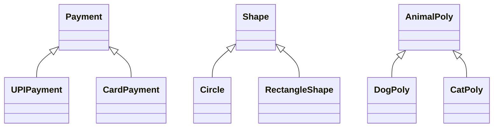

<div align="center">


# ☕ Java Learning Journey

[](https://www.java.com/)
[](https://github.com/tejasbargat16-ux/Java-Learning-Journey)
[](https://github.com/tejasbargat16-ux/Java-Learning-Journey)
[](https://github.com/tejasbargat16-ux)

**From Basic Syntax to Real-World Projects**  
*« Learn → Code → Practice → Build → Repeat 🔥 »*

---

</div>

## 📌 About The Journey

Welcome to my **Java Learning Journey**! 🚀

This repository documents my structured 60-day roadmap from core syntax fundamentals to advanced Object-Oriented Programming (OOP) and real-world projects. Every day includes documented source code, concept notes, and practical problem-solving exercises.

---

## 🗺️ 60-Day Roadmap & Milestones

<div align="center">
  
</div>

---

## 🎯 My Goals

- 🧩 **Solid Foundations:** Master core Java syntax, operators, and control flow.
- 🧱 **Object-Oriented Excellence:** Deeply understand encapsulation, inheritance, polymorphism, and abstraction.
- 📦 **Data Structures & Collections:** Implement lists, sets, maps, queues, and explore their time complexities.
- 💾 **Data Persistence:** Work with Java File I/O and connect databases using JDBC & MySQL.
- 🛠️ **Real-World Projects:** Build robust console apps and full-stack software.
- 📖 **Document & Share:** Commit daily code to showcase consistent growth publicly on GitHub.

---

## 📚 Topics Covered

| Day | Topic | Highlights & Key Concepts | Status |
|:---:|:---|:---|:---:|
| **01** | [Basics](Day-01-Basics) | Hello World, Variables, Data Types, Basic Calculations | ✅ Completed |
| **02** | [Input & Operators](Day-02-Input-Operators) | Scanner Class, Arithmetic, Logical & Relational Operators | ✅ Completed |
| **03** | [Conditional Statements](Day-03-Conditional-Statements) | If-Else, Nested If, Switch Case, Grade & Bill Calculators | ✅ Completed |
| **04** | [Loops](Day-04-Loops) | For, While, Do-While, Break & Continue, Star Patterns, Fibonacci | ✅ Completed |
| **05** | [Arrays](Day-05-Arrays) | 1D & 2D Arrays, Element Search, Sorting, Matrix Operations | ✅ Completed |
| **06** | [Strings](Day-06-Strings) | String Methods, Immutability, Palindromes, Word & Char Counters | ✅ Completed |
| **07** | [Methods](Day-07-Methods) | Method Parameters, Return Types, Method Overloading, Recursion | ✅ Completed |
| **08** | [Classes & Objects](Day-08-Classes-Objects) | OOP Paradigm, Constructors, Instance Variables, `this` Keyword | ✅ Completed |
| **09** | [Encapsulation](Day-09-Encapsulation) | Access Modifiers, Getters & Setters, Data Hiding, Bank Demo | ✅ Completed |
| **10** | [Inheritance](Day-10-Inheritance) | `extends`, `super` Keyword, Method Overriding, Hierarchical Models | ✅ Completed |
| **11** | [Polymorphism](Day-11-Polymorphism) | Method Overloading & Overriding, Dynamic Dispatch, Payment & Shape Demos | ✅ Completed |

---

## 🔜 Coming Up Next

```
Day 12 - 20: Abstraction, Interfaces & Abstract Classes
Day 21 - 30: Exception Handling, Generics & Java Collections Framework (List, Set, Map)
Day 31 - 40: Java File I/O, Serialization, Multithreading & Concurrency
Day 41 - 50: JDBC & MySQL Database Connectivity (CRUD Operations & PreparedStatements)
Day 51 - 60: Real-World Applications & Capstone Projects
```

---

## 🏗️ Architecture & Concepts

### 1. Learning Progression Flow


### 2. Inheritance Hierarchy (Day 10 Showcase)



### 3. Polymorphism Hierarchy (Day 11 Showcase)



---

## 📓 Notes

> Short revision notes for every day, in the `Notes/` folder.

<!-- NOTES:START -->
| Day | Topic | Notes |
|:---:|:---|:---|
| **01** | Basics | [📓 Open notes](Notes/Day-01-Basics.md) |
| **02** | Input Operators | [📓 Open notes](Notes/Day-02-Input-Operators.md) |
| **03** | Conditional Statements | [📓 Open notes](Notes/Day-03-Conditional-Statements.md) |
| **04** | Loops | [📓 Open notes](Notes/Day-04-Loops.md) |
| **05** | Arrays | [📓 Open notes](Notes/Day-05-Arrays.md) |
| **06** | Strings | [📓 Open notes](Notes/Day-06-Strings.md) |
| **07** | Methods | [📓 Open notes](Notes/Day-07-Methods.md) |
| **08** | Classes Objects | [📓 Open notes](Notes/Day-08-Classes-Objects.md) |
| **09** | Encapsulation | [📓 Open notes](Notes/Day-09-Encapsulation.md) |
| **10** | Inheritance | [📓 Open notes](Notes/Day-10-Inheritance.md) |
| **11** | Polymorphism | [📓 Open notes](Notes/Day-11-Polymorphism.md) |
<!-- NOTES:END -->

---

## 🗂️ Repository Structure

> 🤖 This section is auto-updated by a GitHub Action on every push.

<!-- STRUCTURE:START -->
**14 folders · 171 files** — tap a folder to expand 👇

<details>
<summary>📁 <b>Day-01-Basics</b> — 8 files</summary>

- ☕ [BasicCalculation.java](Day-01-Basics/BasicCalculation.java)
- ☕ [Calculator.java](Day-01-Basics/Calculator.java)
- ☕ [HelloWorld.java](Day-01-Basics/HelloWorld.java)
- ☕ [MyIntroduction.java](Day-01-Basics/MyIntroduction.java)
- ☕ [PersonalProfile.java](Day-01-Basics/PersonalProfile.java)
- 📝 [README.md](Day-01-Basics/README.md)
- ☕ [StudentDetails.java](Day-01-Basics/StudentDetails.java)
- ☕ [Variables.java](Day-01-Basics/Variables.java)

</details>

<details>
<summary>📁 <b>Day-02-Input-Operators</b> — 9 files</summary>

- ☕ [ArithmeticOperators.java](Day-02-Input-Operators/ArithmeticOperators.java)
- ☕ [Calculator.java](Day-02-Input-Operators/Calculator.java)
- ☕ [MarksCalculator.java](Day-02-Input-Operators/MarksCalculator.java)
- ☕ [PersonalInfo.java](Day-02-Input-Operators/PersonalInfo.java)
- 📝 [README.md](Day-02-Input-Operators/README.md)
- ☕ [RectangleCalculator.java](Day-02-Input-Operators/RectangleCalculator.java)
- ☕ [SimpleInterest.java](Day-02-Input-Operators/SimpleInterest.java)
- ☕ [StudentInput.java](Day-02-Input-Operators/StudentInput.java)
- ☕ [UserInput.java](Day-02-Input-Operators/UserInput.java)

</details>

<details>
<summary>📁 <b>Day-03-Conditional-Statements</b> — 12 files</summary>

- ☕ [AgeChecker.java](Day-03-Conditional-Statements/AgeChecker.java)
- ☕ [ElectricityBill.java](Day-03-Conditional-Statements/ElectricityBill.java)
- ☕ [EvenOdd.java](Day-03-Conditional-Statements/EvenOdd.java)
- ☕ [GradeCalculator.java](Day-03-Conditional-Statements/GradeCalculator.java)
- ☕ [IfElseExample.java](Day-03-Conditional-Statements/IfElseExample.java)
- ☕ [IfExample.java](Day-03-Conditional-Statements/IfExample.java)
- ☕ [LargestNumber.java](Day-03-Conditional-Statements/LargestNumber.java)
- ☕ [LargestOfThree.java](Day-03-Conditional-Statements/LargestOfThree.java)
- ☕ [LoginChecker.java](Day-03-Conditional-Statements/LoginChecker.java)
- ☕ [NumberChecker.java](Day-03-Conditional-Statements/NumberChecker.java)
- ☕ [PracticeResult.java](Day-03-Conditional-Statements/PracticeResult.java)
- 📝 [README.md](Day-03-Conditional-Statements/README.md)

</details>

<details>
<summary>📁 <b>Day-04-Loops</b> — 18 files</summary>

- ☕ [BreakExample.java](Day-04-Loops/BreakExample.java)
- ☕ [ContinueExample.java](Day-04-Loops/ContinueExample.java)
- ☕ [CountDigits.java](Day-04-Loops/CountDigits.java)
- ☕ [Countdown.java](Day-04-Loops/Countdown.java)
- ☕ [DoWhileLoop.java](Day-04-Loops/DoWhileLoop.java)
- ☕ [EvenNumbers.java](Day-04-Loops/EvenNumbers.java)
- ☕ [Factorial.java](Day-04-Loops/Factorial.java)
- ☕ [Fibonacci.java](Day-04-Loops/Fibonacci.java)
- ☕ [ForLoop.java](Day-04-Loops/ForLoop.java)
- ☕ [NumberAnalyzer.java](Day-04-Loops/NumberAnalyzer.java)
- ☕ [NumberTable.java](Day-04-Loops/NumberTable.java)
- ☕ [PracticeSum.java](Day-04-Loops/PracticeSum.java)
- ☕ [PrimeNumber.java](Day-04-Loops/PrimeNumber.java)
- 📝 [README.md](Day-04-Loops/README.md)
- ☕ [ReverseNumber.java](Day-04-Loops/ReverseNumber.java)
- ☕ [StarPattern.java](Day-04-Loops/StarPattern.java)
- ☕ [SumOfNumbers.java](Day-04-Loops/SumOfNumbers.java)
- ☕ [WhileLoop.java](Day-04-Loops/WhileLoop.java)

</details>

<details>
<summary>📁 <b>Day-05-Arrays</b> — 14 files</summary>

- ☕ [ArrayAnalyzer.java](Day-05-Arrays/ArrayAnalyzer.java)
- ☕ [ArrayAverage.java](Day-05-Arrays/ArrayAverage.java)
- ☕ [ArrayBasics.java](Day-05-Arrays/ArrayBasics.java)
- ☕ [ArrayInput.java](Day-05-Arrays/ArrayInput.java)
- ☕ [ArraySum.java](Day-05-Arrays/ArraySum.java)
- ☕ [MatrixAddition.java](Day-05-Arrays/MatrixAddition.java)
- ☕ [MaximumElement.java](Day-05-Arrays/MaximumElement.java)
- ☕ [MinimumElement.java](Day-05-Arrays/MinimumElement.java)
- ☕ [PracticeEvenArray.java](Day-05-Arrays/PracticeEvenArray.java)
- 📝 [README.md](Day-05-Arrays/README.md)
- ☕ [ReverseArray.java](Day-05-Arrays/ReverseArray.java)
- ☕ [SearchElement.java](Day-05-Arrays/SearchElement.java)
- ☕ [SortArray.java](Day-05-Arrays/SortArray.java)
- ☕ [TwoDimensionalArray.java](Day-05-Arrays/TwoDimensionalArray.java)

</details>

<details>
<summary>📁 <b>Day-06-Strings</b> — 17 files</summary>

- ☕ [CharacterAccess.java](Day-06-Strings/CharacterAccess.java)
- ☕ [CharacterCounter.java](Day-06-Strings/CharacterCounter.java)
- ☕ [CharacterFrequency.java](Day-06-Strings/CharacterFrequency.java)
- ☕ [Palindrome.java](Day-06-Strings/Palindrome.java)
- 📝 [README.md](Day-06-Strings/README.md)
- ☕ [RemoveSpaces.java](Day-06-Strings/RemoveSpaces.java)
- ☕ [ReverseString.java](Day-06-Strings/ReverseString.java)
- ☕ [StringAnalyzer.java](Day-06-Strings/StringAnalyzer.java)
- ☕ [StringBasics.java](Day-06-Strings/StringBasics.java)
- ☕ [StringCase.java](Day-06-Strings/StringCase.java)
- ☕ [StringComparison.java](Day-06-Strings/StringComparison.java)
- ☕ [StringLength.java](Day-06-Strings/StringLength.java)
- ☕ [StringSearch.java](Day-06-Strings/StringSearch.java)
- ☕ [SubstringExample.java](Day-06-Strings/SubstringExample.java)
- ☕ [VowelConsonant.java](Day-06-Strings/VowelConsonant.java)
- ☕ [VowelCounter.java](Day-06-Strings/VowelCounter.java)
- ☕ [WordCounter.java](Day-06-Strings/WordCounter.java)

</details>

<details>
<summary>📁 <b>Day-07-Methods</b> — 13 files</summary>

- ☕ [ArrayMethods.java](Day-07-Methods/ArrayMethods.java)
- ☕ [CalculatorMethods.java](Day-07-Methods/CalculatorMethods.java)
- ☕ [EvenOddMethod.java](Day-07-Methods/EvenOddMethod.java)
- ☕ [FactorialMethod.java](Day-07-Methods/FactorialMethod.java)
- ☕ [LargestMethod.java](Day-07-Methods/LargestMethod.java)
- ☕ [MethodOverloading.java](Day-07-Methods/MethodOverloading.java)
- ☕ [ParameterMethod.java](Day-07-Methods/ParameterMethod.java)
- ☕ [PracticeMethods.java](Day-07-Methods/PracticeMethods.java)
- 📝 [README.md](Day-07-Methods/README.md)
- ☕ [ReturnMethod.java](Day-07-Methods/ReturnMethod.java)
- ☕ [SimpleMethod.java](Day-07-Methods/SimpleMethod.java)
- ☕ [StringMethods.java](Day-07-Methods/StringMethods.java)
- ☕ [StudentResult.java](Day-07-Methods/StudentResult.java)

</details>

<details>
<summary>📁 <b>Day-08-Classes-Objects</b> — 17 files</summary>

- ☕ [BankAccount.java](Day-08-Classes-Objects/BankAccount.java)
- ☕ [BankDemo.java](Day-08-Classes-Objects/BankDemo.java)
- ☕ [Car.java](Day-08-Classes-Objects/Car.java)
- ☕ [CarDemo.java](Day-08-Classes-Objects/CarDemo.java)
- ☕ [ConstructorExample.java](Day-08-Classes-Objects/ConstructorExample.java)
- ☕ [Employee.java](Day-08-Classes-Objects/Employee.java)
- ☕ [EmployeeDemo.java](Day-08-Classes-Objects/EmployeeDemo.java)
- ☕ [MobileDemo.java](Day-08-Classes-Objects/MobileDemo.java)
- ☕ [MobilePhone.java](Day-08-Classes-Objects/MobilePhone.java)
- 📝 [README.md](Day-08-Classes-Objects/README.md)
- ☕ [Rectangle.java](Day-08-Classes-Objects/Rectangle.java)
- ☕ [RectangleDemo.java](Day-08-Classes-Objects/RectangleDemo.java)
- ☕ [Student.java](Day-08-Classes-Objects/Student.java)
- ☕ [StudentDemo.java](Day-08-Classes-Objects/StudentDemo.java)
- ☕ [StudentManagement.java](Day-08-Classes-Objects/StudentManagement.java)
- ☕ [Students.java](Day-08-Classes-Objects/Students.java)
- ☕ [ThisKeyword.java](Day-08-Classes-Objects/ThisKeyword.java)

</details>

<details>
<summary>📁 <b>Day-09-Encapsulation</b> — 14 files</summary>

- ☕ [BankAccount.java](Day-09-Encapsulation/BankAccount.java)
- ☕ [BankAccountPractice.java](Day-09-Encapsulation/BankAccountPractice.java)
- ☕ [BankDemo.java](Day-09-Encapsulation/BankDemo.java)
- ☕ [Employee.java](Day-09-Encapsulation/Employee.java)
- ☕ [EmployeeDemo.java](Day-09-Encapsulation/EmployeeDemo.java)
- ☕ [EncapsulationBasic.java](Day-09-Encapsulation/EncapsulationBasic.java)
- ☕ [Mobile.java](Day-09-Encapsulation/Mobile.java)
- ☕ [Person.java](Day-09-Encapsulation/Person.java)
- ☕ [Product.java](Day-09-Encapsulation/Product.java)
- ☕ [ProductDemo.java](Day-09-Encapsulation/ProductDemo.java)
- 📝 [README.md](Day-09-Encapsulation/README.md)
- ☕ [SecureStudent.java](Day-09-Encapsulation/SecureStudent.java)
- ☕ [Student.java](Day-09-Encapsulation/Student.java)
- ☕ [StudentDemo.java](Day-09-Encapsulation/StudentDemo.java)

</details>

<details>
<summary>📁 <b>Day-10-Inheritance</b> — 16 files</summary>

- ☕ [Animal.java](Day-10-Inheritance/Animal.java)
- ☕ [AnimalDemo.java](Day-10-Inheritance/AnimalDemo.java)
- ☕ [Car.java](Day-10-Inheritance/Car.java)
- ☕ [Developer.java](Day-10-Inheritance/Developer.java)
- ☕ [Dog.java](Day-10-Inheritance/Dog.java)
- ☕ [Employee.java](Day-10-Inheritance/Employee.java)
- ☕ [EmployeeManagement.java](Day-10-Inheritance/EmployeeManagement.java)
- ☕ [Main.java](Day-10-Inheritance/Main.java)
- ☕ [Person.java](Day-10-Inheritance/Person.java)
- 📝 [README.md](Day-10-Inheritance/README.md)
- ☕ [RectanglePractice.java](Day-10-Inheritance/RectanglePractice.java)
- ☕ [Student.java](Day-10-Inheritance/Student.java)
- ☕ [StudentDemo.java](Day-10-Inheritance/StudentDemo.java)
- ☕ [TeacherPractice.java](Day-10-Inheritance/TeacherPractice.java)
- ☕ [Vehicle.java](Day-10-Inheritance/Vehicle.java)
- ☕ [VehicleDemo.java](Day-10-Inheritance/VehicleDemo.java)

</details>

<details>
<summary>📁 <b>Day-11-Polymorphism</b> — 18 files</summary>

- ☕ [AnimalArrayDemo.java](Day-11-Polymorphism/AnimalArrayDemo.java)
- ☕ [AnimalPoly.java](Day-11-Polymorphism/AnimalPoly.java)
- ☕ [AreaOverloading.java](Day-11-Polymorphism/AreaOverloading.java)
- ☕ [CalculatorOverloading.java](Day-11-Polymorphism/CalculatorOverloading.java)
- ☕ [CardPayment.java](Day-11-Polymorphism/CardPayment.java)
- ☕ [CatPoly.java](Day-11-Polymorphism/CatPoly.java)
- ☕ [Circle.java](Day-11-Polymorphism/Circle.java)
- ☕ [DogPoly.java](Day-11-Polymorphism/DogPoly.java)
- ☕ [EmployeeSalaryDemo.java](Day-11-Polymorphism/EmployeeSalaryDemo.java)
- ☕ [NotificationDemo.java](Day-11-Polymorphism/NotificationDemo.java)
- ☕ [Payment.java](Day-11-Polymorphism/Payment.java)
- ☕ [PaymentDemo.java](Day-11-Polymorphism/PaymentDemo.java)
- ☕ [PolymorphismDemo.java](Day-11-Polymorphism/PolymorphismDemo.java)
- 📝 [README.md](Day-11-Polymorphism/README.md)
- ☕ [RectangleShape.java](Day-11-Polymorphism/RectangleShape.java)
- ☕ [Shape.java](Day-11-Polymorphism/Shape.java)
- ☕ [ShapeCalculator.java](Day-11-Polymorphism/ShapeCalculator.java)
- ☕ [UPIPayment.java](Day-11-Polymorphism/UPIPayment.java)

</details>

<details>
<summary>📁 <b>Notes</b> — 11 files</summary>

- 📝 [Day-01-Basics.md](Notes/Day-01-Basics.md)
- 📝 [Day-02-Input-Operators.md](Notes/Day-02-Input-Operators.md)
- 📝 [Day-03-Conditional-Statements.md](Notes/Day-03-Conditional-Statements.md)
- 📝 [Day-04-Loops.md](Notes/Day-04-Loops.md)
- 📝 [Day-05-Arrays.md](Notes/Day-05-Arrays.md)
- 📝 [Day-06-Strings.md](Notes/Day-06-Strings.md)
- 📝 [Day-07-Methods.md](Notes/Day-07-Methods.md)
- 📝 [Day-08-Classes-Objects.md](Notes/Day-08-Classes-Objects.md)
- 📝 [Day-09-Encapsulation.md](Notes/Day-09-Encapsulation.md)
- 📝 [Day-10-Inheritance.md](Notes/Day-10-Inheritance.md)
- 📝 [Day-11-Polymorphism.md](Notes/Day-11-Polymorphism.md)

</details>

<details>
<summary>📁 <b>images</b> — 2 files</summary>

- 🖼️ [banner.png](images/banner.png)
- 🖼️ [roadmap.jpg](images/roadmap.jpg)

</details>

<details>
<summary>📁 <b>scripts</b> — 1 files</summary>

- 🐍 [auto_update.py](scripts/auto_update.py)

</details>

<details>
<summary>📁 <b>Root files</b> — 1 files</summary>

- 📝 [README.md](README.md)

</details>
<!-- STRUCTURE:END -->

> Each day folder contains dedicated Java source files, practice programs, and a `README.md` explaining theory and problem statements.

---

## ▶️ How to Run

### Prerequisites
- [JDK 17+](https://www.oracle.com/java/technologies/downloads/) installed.
- Terminal or any IDE (VS Code, IntelliJ IDEA, Eclipse). On Android, Termux with `pkg install openjdk-17` works too.

### Compile & Execute Any Program

1. **Clone the repository:**
   ```bash
   git clone https://github.com/tejasbargat16-ux/Java-Learning-Journey.git
   cd Java-Learning-Journey
   ```

2. **Navigate to the topic folder:**
   ```bash
   cd Day-01-Basics
   ```

3. **Compile the Java file:**
   ```bash
   javac HelloWorld.java
   ```

4. **Run the compiled bytecode:**
   ```bash
   java HelloWorld
   ```

> 💡 **Note:** Class names must match their `.java` file name when compiling and running Java programs.

---

## 📈 Current Progress

- **Completed:** Day 11 of 60 days
- **Status:** In Progress 🚀
- **Started:** September 2026

<div align="center">

**« Keep Learning, Keep Building, Keep Growing »**  
*Built with ❤️ by Tejas*

</div>


